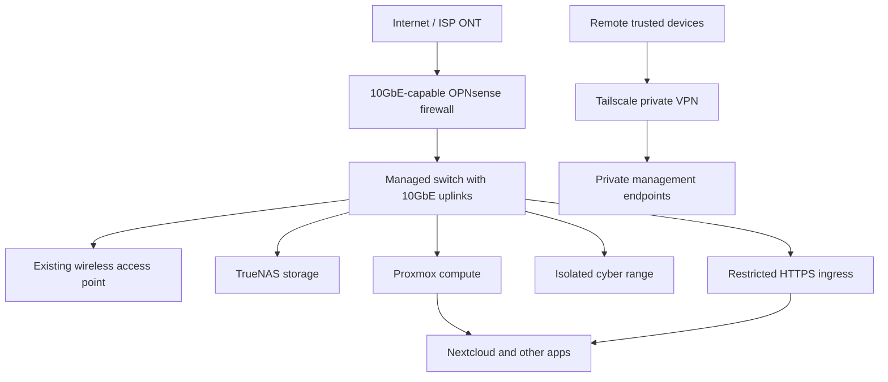

# 🛡️ Project NEXUS

> A public, reproducible, security-first home lab reference architecture: high-speed networking, TrueNAS storage, Proxmox, private cloud, secure access, monitoring, and AI automation.

**Status:** Design / Phase 1 network assessment · **Updated:** 2026-10-19

## Guiding principles

- Document **planned** architecture separately from **as-built** installation.
- Never publish public IPs, account identifiers, credentials, serial numbers, VPN keys, or configuration exports containing private metadata.
- Prefer least privilege, segmentation, reproducible changes, and independently tested backups.
- Keep administration private through Tailscale; expose selected HTTPS applications only through restricted ingress.
- Each phase requires validation and rollback instructions.

## Conceptual architecture

This is a **planned logical concept**, not a depiction of installed equipment. Public HTTPS ingress will require explicitly tested firewall and proxy controls.

## Development roadmap

| Phase | Capability | Status |
|---|---|---|
| 01 | 10GbE networking, OPNsense, VLANs, Tailscale | Planning |
| 02 | TrueNAS, ZFS, storage permissions | Planned |
| 03 | Proxmox, Nextcloud, private cloud | Planned |
| 04 | Independent backup and restore verification | Planned |
| 05 | Security monitoring, isolated cyber range | Planned |
| 06 | Local AI assistant and approved automation | Planned |
| 07 | Multi-host growth and resiliency | Planned |

Start with [Phase 01](phases/01-network-foundation/README.md), [network design](docs/architecture/logical-network.md), and [procurement](procurement/phase-01.md).

## Design constraints

A 5 Gbps service tier is the assumed planning requirement. ISP handoff and measured throughput are **not yet verified**. The existing Wi-Fi router may be reused in AP mode, with its wired uplink limitations documented. Hardware models will be chosen after compatibility verification.

## Publishing and safety

All identifiers are illustrative. Production configs, secrets, actual endpoints, and internal inventories belong outside this public repository. Never blindly apply an example to a live home network. See [SECURITY.md](SECURITY.md) and [CONTRIBUTING.md](CONTRIBUTING.md).
