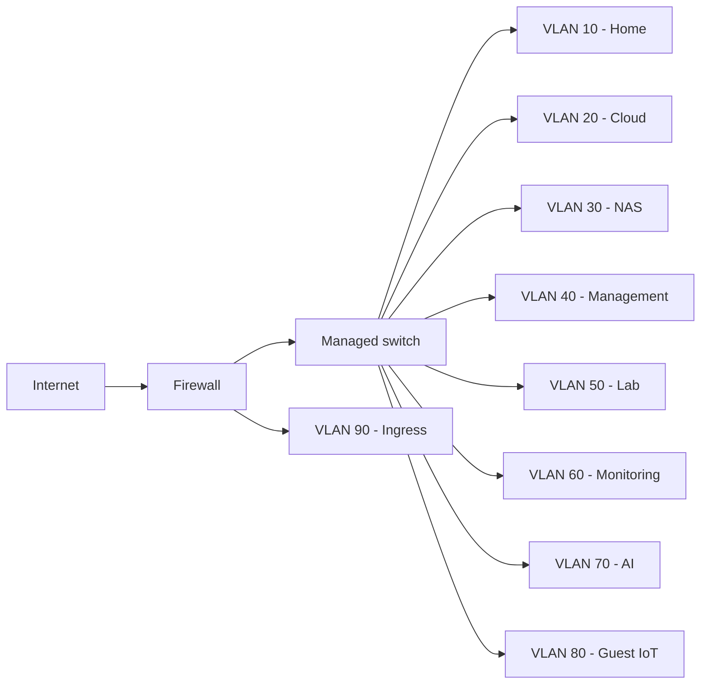

# Proposed logical network design

| VLAN | Example subnet | Role |
|---|---|---|
| 10 | 10.10.10.0/24 | Trusted household clients |
| 20 | 10.10.20.0/24 | Private cloud services |
| 30 | 10.10.30.0/24 | Storage |
| 40 | 10.10.40.0/24 | Management |
| 50 | 10.10.50.0/24 | Isolated cyber range |
| 60 | 10.10.60.0/24 | Security telemetry |
| 70 | 10.10.70.0/24 | AI systems |
| 80 | 10.10.80.0/24 | Guest/IoT |
| 90 | 10.10.90.0/24 | Application ingress |

All ranges are examples. Start with the minimum networks required; reserve the others for later.

## Firewall philosophy

Default deny between zones, with explicit approved flows. The cyber range must not have broad access to home clients, storage, or management. Review IPv4 and IPv6 policies. Preserve a local break-glass administration path.

## Hybrid access

Use Tailscale with MFA/device policy for private administration. Publish *only* deliberately selected applications through dedicated HTTPS ingress with minimal firewall access and app-level authentication. Do not publish hypervisor, NAS, SSH, or firewall administration interfaces.
